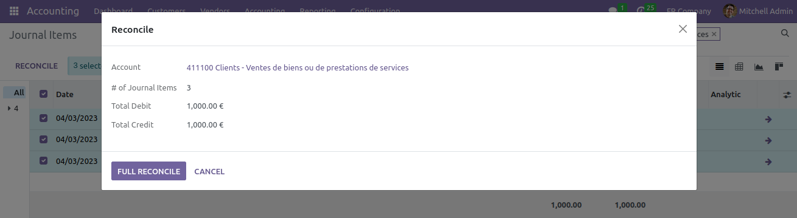
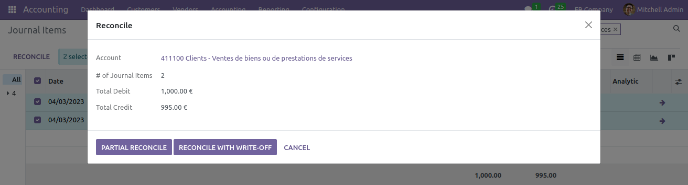
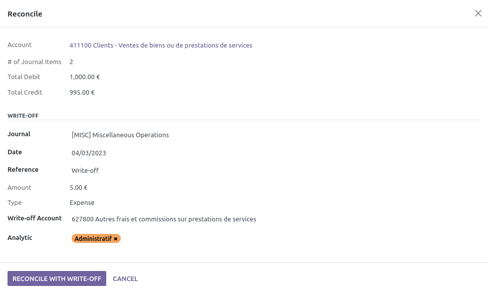

.. image:: https://odoo-community.org/readme-banner-image
   :target: https://odoo-community.org/get-involved?utm_source=readme
   :alt: Odoo Community Association

==================================
Account Move Line Reconcile Manual
==================================

.. 
   !!!!!!!!!!!!!!!!!!!!!!!!!!!!!!!!!!!!!!!!!!!!!!!!!!!!
   !! This file is generated by oca-gen-addon-readme !!
   !! changes will be overwritten.                   !!
   !!!!!!!!!!!!!!!!!!!!!!!!!!!!!!!!!!!!!!!!!!!!!!!!!!!!
   !! source digest: sha256:0fc03f66c2228d2de1b7d6465662cff5ffedfa9b9b20e40cfc50215f7936a876
   !!!!!!!!!!!!!!!!!!!!!!!!!!!!!!!!!!!!!!!!!!!!!!!!!!!!

.. |badge1| image:: https://img.shields.io/badge/maturity-Beta-yellow.png
    :target: https://odoo-community.org/page/development-status
    :alt: Beta
.. |badge2| image:: https://img.shields.io/badge/license-AGPL--3-blue.png
    :target: http://www.gnu.org/licenses/agpl-3.0-standalone.html
    :alt: License: AGPL-3
.. |badge3| image:: https://img.shields.io/badge/github-OCA%2Faccount--reconcile-lightgray.png?logo=github
    :target: https://github.com/OCA/account-reconcile/tree/19.0/account_move_line_reconcile_manual
    :alt: OCA/account-reconcile
.. |badge4| image:: https://img.shields.io/badge/weblate-Translate%20me-F47D42.png
    :target: https://translation.odoo-community.org/projects/account-reconcile-19-0/account-reconcile-19-0-account_move_line_reconcile_manual
    :alt: Translate me on Weblate
.. |badge5| image:: https://img.shields.io/badge/runboat-Try%20me-875A7B.png
    :target: https://runboat.odoo-community.org/builds?repo=OCA/account-reconcile&target_branch=19.0
    :alt: Try me on Runboat

|badge1| |badge2| |badge3| |badge4| |badge5|

This module adds a wizard to reconcile manually selected journal items.
If the selected journal items are balanced, it will propose a full
reconcile. Otherwise, the user will have to choose between partial
reconciliation and full reconciliation with a write-off.

For the old-time Odoo users, the feature provided by this module is
similar to the wizard that was provided in the **account** module up to
Odoo 11.0. It was later replaced by the special reconciliation JS
interface, which was working well, but was not as fast and convenient.

Full reconciliation:

|image1|

Choose between partial reconciliation and full reconciliation with a
write-off:

|image2|

Reconcile with write-off:

|image3|

**Table of contents**

.. contents::
   :local:

Configuration
=============

Write-off models are optional: they prefill the journal, reference,
account and analytic distribution of a write-off.

1. Go to *Invoicing > Configuration > Accounting > Write-off Models*.
2. Create a model with a **Write-off Reference**, an **Expense Write-off
   Account**, an **Income Write-off Account** and a **Write-off
   Journal**. Optionally, set the **Analytic for Expense** and
   **Analytic for Income**.

Usage
=====

1. Go to *Invoicing > Review > Control > Journal Items*.
2. Select the journal items to reconcile. They must share the same
   reconcilable account, not be fully reconciled yet, and include at
   least one debit and one credit.
3. Click **Reconcile** in the list header. The wizard shows the account,
   the number of journal items and their total debit and credit, with a
   warning when they belong to several partners.
4. If the journal items are balanced, click **Full Reconcile**.
5. Otherwise, click **Partial Reconcile** to leave the difference open,
   or **Reconcile with Write-off** to settle it:

   1. Select a **Model**, or fill in the **Journal**, **Date**,
      **Reference**, **Write-off Account** and **Analytic** yourself.
   2. Click **Reconcile with Write-off**: a write-off journal entry is
      posted for the difference and all the journal items are fully
      reconciled.

Bug Tracker
===========

Bugs are tracked on `GitHub Issues <https://github.com/OCA/account-reconcile/issues>`_.
In case of trouble, please check there if your issue has already been reported.
If you spotted it first, help us to smash it by providing a detailed and welcomed
`feedback <https://github.com/OCA/account-reconcile/issues/new?body=module:%20account_move_line_reconcile_manual%0Aversion:%2019.0%0A%0A**Steps%20to%20reproduce**%0A-%20...%0A%0A**Current%20behavior**%0A%0A**Expected%20behavior**>`_.

Do not contact contributors directly about support or help with technical issues.

Credits
=======

Authors
-------

* Akretion

Contributors
------------

- Alexis de Lattre <alexis.delattre@akretion.com>

Maintainers
-----------

This module is maintained by the OCA.

.. image:: https://odoo-community.org/logo.png
   :alt: Odoo Community Association
   :target: https://odoo-community.org

OCA, or the Odoo Community Association, is a nonprofit organization whose
mission is to support the collaborative development of Odoo features and
promote its widespread use.

.. |maintainer-alexis-via| image:: https://github.com/alexis-via.png?size=40px
    :target: https://github.com/alexis-via
    :alt: alexis-via

Current `maintainer <https://odoo-community.org/page/maintainer-role>`__:

|maintainer-alexis-via| 

This module is part of the `OCA/account-reconcile <https://github.com/OCA/account-reconcile/tree/19.0/account_move_line_reconcile_manual>`_ project on GitHub.

You are welcome to contribute. To learn how please visit https://odoo-community.org/page/Contribute.
